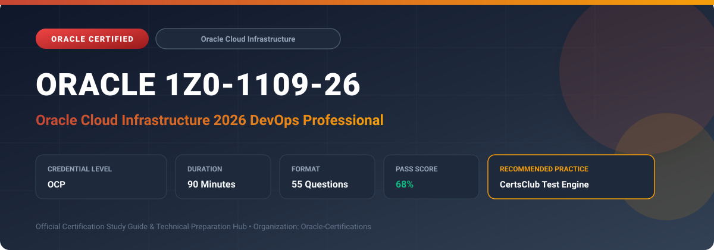

  

# Oracle 1Z0-1109-26: Oracle Cloud Infrastructure 2026 DevOps Professional

---

## 1. Exam Overview & Candidate Profile

The **Oracle 1Z0-1109-26: Oracle Cloud Infrastructure 2026 DevOps Professional** credential validates expertise in building continuous integration, continuous delivery (CI/CD), and automated software release pipelines on OCI.

Candidates prove their ability to manage code repositories, build pipelines, deployment pipelines, deployment environments (OKE, Compute, Functions), artifact repositories, and automated rollback strategies.

### Target Audience & Prerequisites
- **Target Roles**: Implementation Specialists, Cloud Architects, Technical Leads, Enterprise Consultants, and Systems Engineers.
- **Recommended Experience**: 1–2 years of practical, hands-on experience designing, implementing, and maintaining corresponding Oracle solutions.
- **Credential Earned**: OCP Certification.

---

## 2. Key Exam Specifications

| Specification | Details |
| :--- | :--- |
| **Exam Code** | **Oracle 1Z0-1109-26** |
| **Official Title** | Oracle Cloud Infrastructure 2026 DevOps Professional |
| **Certification Track** | Oracle Cloud Infrastructure |
| **Exam Duration** | 90 Minutes |
| **Number of Questions** | 55 Questions |
| **Passing Score** | 68% |
| **Question Format** | Multiple Choice (Single/Multiple Answer), Scenario-Based Questions |
| **Delivery Provider** | Oracle University / Pearson VUE (Online Proctored or Test Center) |
| **Recommended Practice Engine** | [CertsClub Oracle Practice Tests](https://www.certsclub.com/oracle/1z0-1109-26-dumps.html) |

---

## 3. Official Blueprint & Exam Domain Breakdown

The examination assesses candidate competencies across core functional domains weighted as follows:

| Domain Area | Weighting |
| :--- | :--- |
| **DevOps Architecture & Service Management** | `20%` |
| **Code Repositories & Trigger Automations** | `20%` |
| **Build Pipelines & Artifact Management** | `25%` |
| **Deployment Pipelines (OKE, Compute, Functions)** | `25%` |
| **Security, Governance & Observability in DevOps** | `10%` |

---

## 4. Deep Dive into Complex & Challenging Technical Topics

To secure a passing score on the 1Z0-1109-26 exam, candidates must master the following advanced concepts:

- Building CI/CD pipelines with OCI DevOps service: build stages, test stages, artifact delivery, and triggers.
- Deploying blue/green and canary release strategies to OKE and Compute instance groups.
- Integrating OCI Artifact Registry and Container Registry (OCIR) with vulnerability scanning.
- Automating deployments using Helm charts, Kubernetes manifests, and Terraform Resource Manager.
- Securing CI/CD secrets using OCI Vault and IAM dynamic groups.

---

## 5. Scenario-Based Demo & Practice Questions

### Question 1
A DevOps engineer needs to deploy a new version of a microservice to Oracle Container Engine for Kubernetes (OKE) with zero downtime, shifting 10% of traffic initially before full rollout. Which deployment strategy should be implemented?

A) Canary Deployment Strategy
B) Rolling In-Place Overwrite
C) Recreate Strategy
D) All-at-Once Deploy

- **Correct Answer**: `A) Canary Deployment Strategy`  
- **Technical Explanation**: Canary deployment routes a small percentage of production traffic to the new version, monitors stability, and progressively ramps traffic to 100% without downtime.

---

### Question 2
In OCI DevOps, what entity securely connects an external GitHub or GitLab repository to an OCI DevOps build pipeline to initiate builds on code push?

A) External Connection Resource
B) Network Security Group Rule
C) FastConnect Virtual Circuit
D) Private Subnet NAT Gateway

- **Correct Answer**: `A) External Connection Resource`  
- **Technical Explanation**: OCI DevOps External Connections store access tokens securely in OCI Vault and establish authenticated webhooks with third-party Git providers like GitHub or GitLab.

---

## 6. Recommended Preparation Strategy & Practice Testing Engine

Achieving certification in **Oracle 1Z0-1109-26** requires balanced theoretical study and scenario-based simulation practice:

1. **Review Oracle Documentation**: Master architecture guides, implementation workbooks, and administration manuals on the Oracle Help Center.
2. **Hands-on Lab Practice**: Execute real-world configuration, policy setup, and troubleshooting tasks in your cloud tenancy or test instance.
3. **Simulated Exam Drills**: Practice answering timed, scenario-based multiple-choice questions to familiarize yourself with the question formats, traps, and timing constraints.

### Practice With CertsClub
For realistic practice questions, updated dumps, and mock testing environments:
- **Resource**: [CertsClub Oracle Practice Test Engine](https://www.certsclub.com/oracle/1z0-1109-26-dumps.html)
- **Special Discount**: Use coupon code **`club20`** during checkout for an instant **20% discount** on all practice exam bundles and testing engines.

---

## 7. Official Documentation & References

- [Oracle University Certification Registry](https://education.oracle.com/)
- [Oracle Help Center Documentation Portal](https://docs.oracle.com/)
- [Oracle Cloud Infrastructure & Applications Guides](https://docs.oracle.com/en/cloud/)
- [CertsClub Oracle Certification Exam Practice](https://www.certsclub.com/oracle/1z0-1109-26-dumps.html)

---

## 8. SEO & Discovery Keywords

`oracle 1z0-1109-26, oracle 1z0-1109-26 exam, oracle 1z0-1109-26 dumps, 1Z0-1109-26 practice questions, 1Z0-1109-26 study guide, oracle cloud infrastructure 2026 devops professional, certsclub 1z0-1109-26`